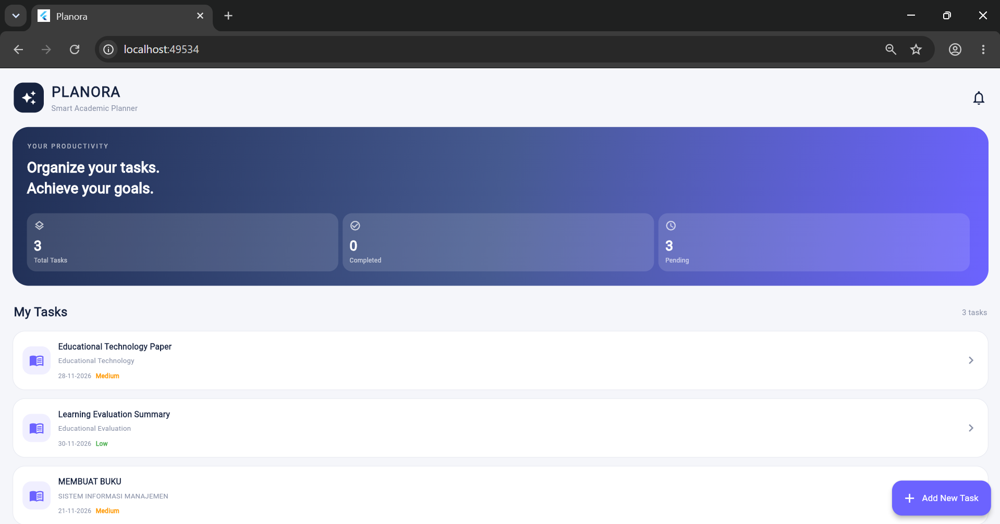
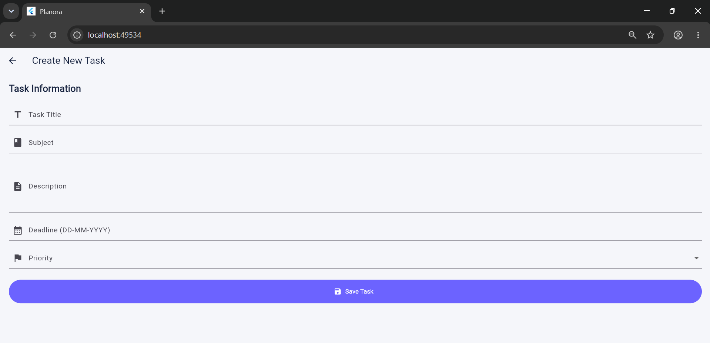
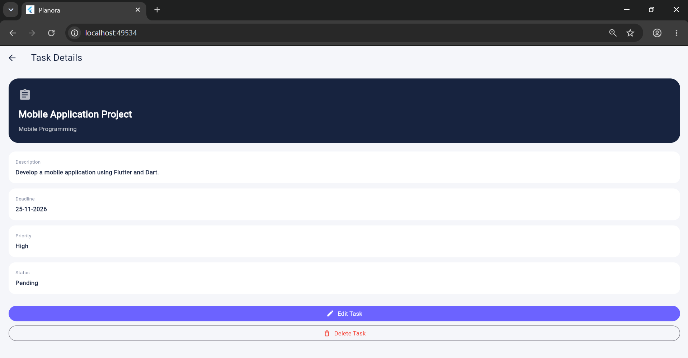
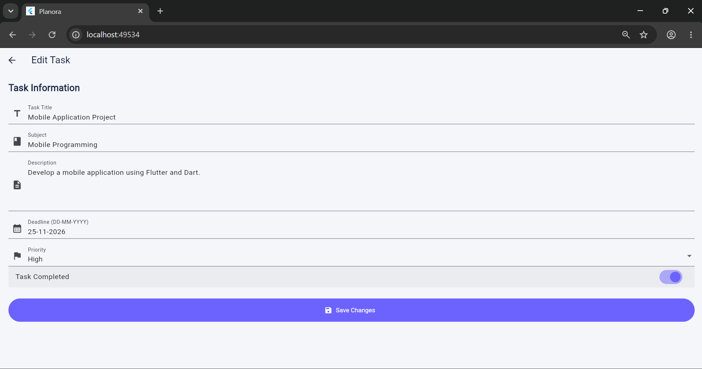
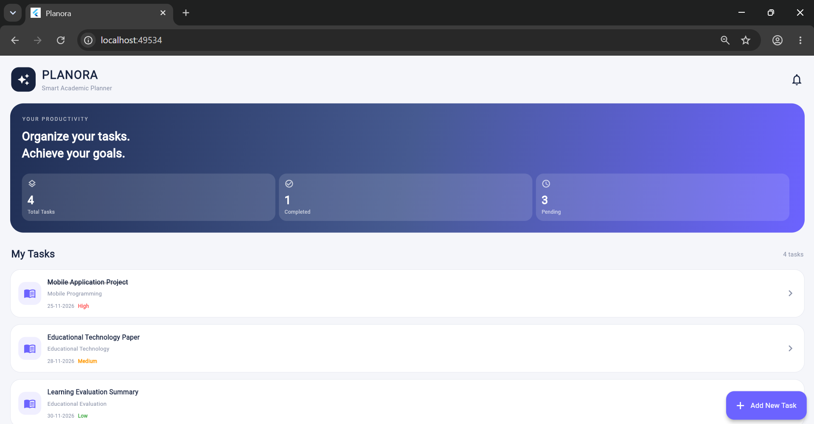
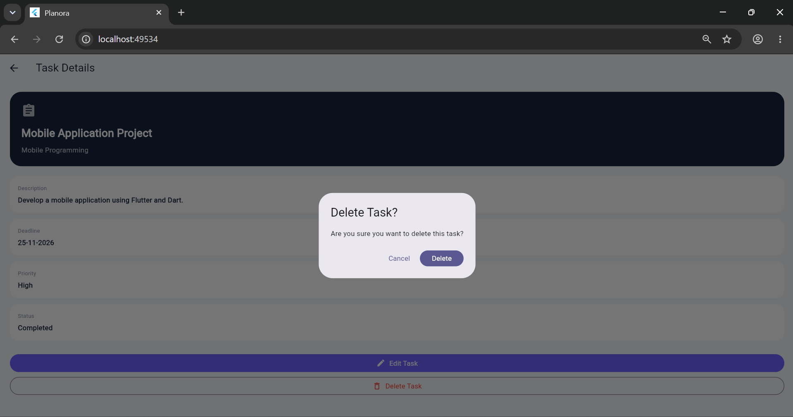

# 📚 Planora – Smart Academic Planner

Planora – Smart Academic Planner merupakan aplikasi mobile berbasis Flutter dan bahasa pemrograman Dart yang dirancang untuk membantu mahasiswa mengelola tugas dan aktivitas akademik agar lebih terorganisir.

Aplikasi ini menerapkan konsep CRUD (*Create, Read, Update, Delete*) dengan tampilan modern, minimalis, dan profesional sehingga memudahkan pengguna dalam mengelola tugas perkuliahan.

## 👨‍🎓 Identitas Pengembang

| Keterangan | Identitas |
|---|---|
| Nama | Zahran Naufal Amar |
| NIM | C2483207012 |
| Program Studi | Pendidikan Teknologi Informasi |
| Fakultas | Keguruan dan Ilmu Pendidikan |
| Universitas | Universitas Muhammadiyah Tasikmalaya |
| Mata Kuliah | Pemrograman Mobile |
| Dosen Pengampu | Alamsyah Firdaus, M.Kom. |
| Tahun Akademik | 2026/2027 Ganjil |

## 🛠️ Teknologi yang Digunakan

- **Flutter** – Framework pengembangan aplikasi mobile.
- **Dart** – Bahasa pemrograman.
- **Material Design 3** – Sistem desain antarmuka aplikasi.
- **Visual Studio Code** – Code editor.
- **Android Emulator** – Untuk menjalankan dan menguji aplikasi.

## ✨ Fitur Aplikasi

1. **Task Dashboard** – Menampilkan ringkasan jumlah seluruh tugas, tugas selesai, dan tugas yang belum selesai.
2. **Menambahkan Tugas (Create)** – Menambahkan tugas baru berdasarkan judul, mata pelajaran, deskripsi, tenggat waktu, dan prioritas.
3. **Melihat Tugas (Read)** – Menampilkan daftar dan detail informasi tugas.
4. **Mengubah Tugas (Update)** – Mengedit informasi tugas yang sudah dibuat.
5. **Menghapus Tugas (Delete)** – Menghapus tugas yang tidak diperlukan.
6. **Form Validation** – Memastikan data yang dimasukkan sesuai dengan ketentuan.
7. **Priority Level** – Mengatur prioritas tugas menjadi Low, Medium, atau High.
8. **Task Status** – Mengubah status penyelesaian tugas.

## 📸 Screenshot Aplikasi

Berikut dokumentasi tampilan aplikasi Planora:

### 1. Halaman Utama (Dashboard)

### 2. Halaman Tambah Tugas

### 3. Halaman Detail Tugas

### 4. Halaman Edit Tugas

### 5. Halaman Sesudah Edit Tugas

### 6. Halaman Hapus Tugas

### 7. Halaman Sesudah Hapus Tugas

## 🎥 Video Demonstrasi
https://youtu.be/oUqEkzGvnCQ
